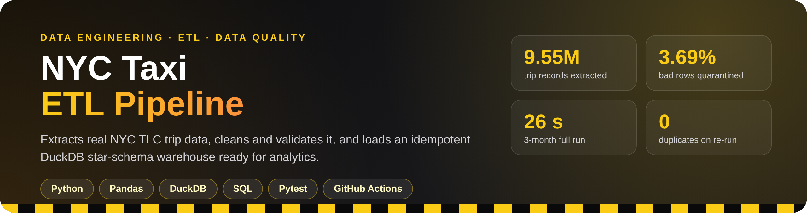
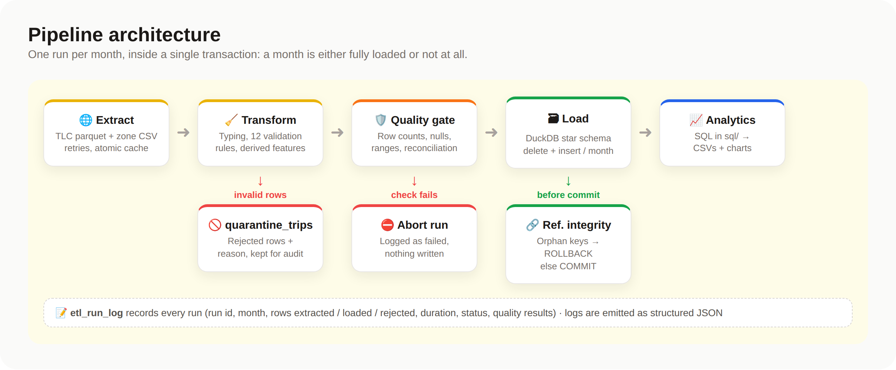
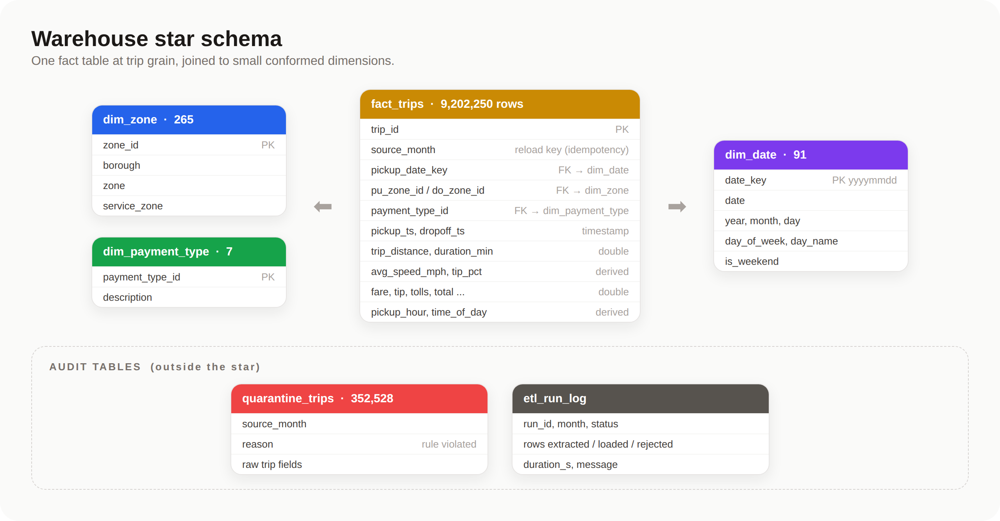
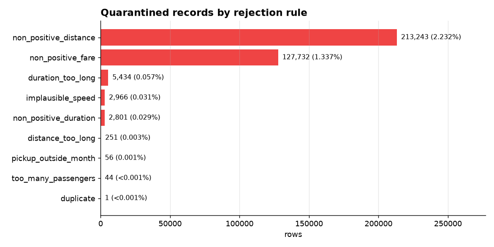
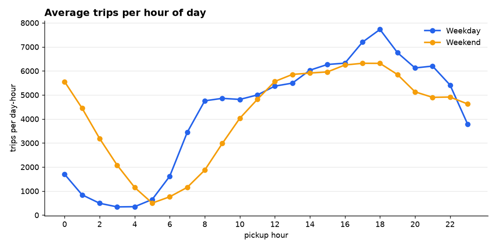
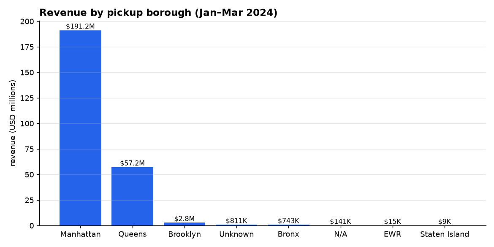
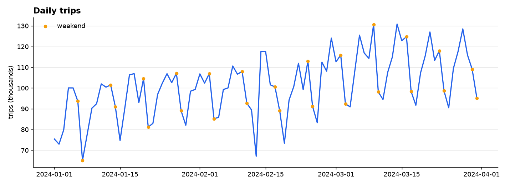

<p align="center">
  
</p>

<p align="center">
  
  
  
  
  
  
</p>

<p align="center">
  <b>A production-style ETL pipeline that turns ~9.5 million raw NYC taxi trips into a clean, validated,<br>analytics-ready star-schema warehouse, with data quality gates, quarantine and idempotent incremental loads.</b>
</p>

---

## 📈 Results from a real run (Jan–Mar 2024)

<table align="center">
  <tr>
    <td align="center"><h2>9,554,778</h2>rows extracted</td>
    <td align="center"><h2>9,202,250</h2>rows loaded</td>
    <td align="center"><h2>352,528</h2>rows quarantined (3.69%)</td>
    <td align="center"><h2>26.2 s</h2>full 3-month run</td>
    <td align="center"><h2>0</h2>duplicates after re-run</td>
  </tr>
</table>

| Month | Extracted | Loaded | Rejected | Rejection % | Load time |
|-------|----------:|-------:|---------:|------------:|----------:|
| 2024-01 | 2,964,624 | 2,866,745 | 97,879 | 3.30% | 7.0 s |
| 2024-02 | 3,007,526 | 2,898,760 | 108,766 | 3.62% | 8.3 s |
| 2024-03 | 3,582,628 | 3,436,745 | 145,883 | 4.07% | 10.4 s |

<sub>Measured on a laptop with the raw files already cached. Re-running 2024-01 afterwards left every table count unchanged.</sub>

## ✨ Highlights

| | |
|---|---|
| 🌐 **Extract** | Downloads monthly TLC parquet files + zone lookup with **retries, exponential backoff and atomic caching** (a half-downloaded file is never reused). |
| 🧹 **Transform** | Type casting, **12 validation rules** (bad timestamps, zero/negative distance or fare, impossible speeds, duplicates…), and derived features: duration, speed, tip %, time of day. |
| 🚫 **Quarantine, not delete** | Every rejected row is stored in `quarantine_trips` with the **rule it violated**, so bad data is auditable. |
| 🛡️ **Quality gates** | Row-count, rejection-rate, null %, value-range and **row-reconciliation** checks; **referential integrity** is checked inside the load transaction. Any failure → rollback. |
| ♻️ **Idempotent incremental loads** | Each month is replaced atomically (delete + insert in one transaction), so re-runs and backfills never duplicate data. |
| ⭐ **Star schema** | `fact_trips` + `dim_zone`, `dim_date`, `dim_payment_type` in **DuckDB**; analytical queries over 9.2M rows return in tens of milliseconds. |
| 📝 **Observability** | Structured **JSON logs** and an `etl_run_log` table recording every run's counts, duration, status and quality results. |
| ✅ **Tested + CI** | 10 pytest tests (rules, quality checks, idempotency, rollback) run on **GitHub Actions** using synthetic fixtures, with no downloads needed. |

## 🏗️ Architecture

<p align="center">
  
</p>

## ⭐ Data model

<p align="center">
  
</p>

## 🔍 Data quality findings

Real TLC data is messy. The pipeline found and quarantined:

<p align="center">
  
</p>

Other issues handled along the way:
- **Timestamps outside the file's month** (some going back to 2002) are rejected as `pickup_outside_month`.
- **Optional fields are null for 6.8% of loaded trips** (`passenger_count`, `rate_code_id`, surcharges). They are kept as NULL rather than rejected, because required fields are all present.
- The zone lookup uses the literal string **"N/A"** as a borough name, which pandas silently converts to NaN by default. The extractor reads it with `keep_default_na=False` so the dimension stays complete.

## 📊 Analytics on the warehouse

SQL lives in [`sql/`](sql) and `python -m src.analytics` exports each result to CSV and charts in [`reports/`](reports).

<table>
  <tr>
    <td></td>
    <td></td>
  </tr>
</table>

<p align="center">
  
</p>

**Insights from Jan–Mar 2024**
- **Manhattan** accounts for 89.9% of trips and $191.2M of the $253.0M total revenue (75.6%).
- **Queens** pickups have the highest average fare ($52.81 vs $15.31 in Manhattan) with 12.7-mile average trips: 87.0% of Queens pickups are at JFK or LaGuardia airport.
- Weekday demand peaks at **18:00** (~7,700 trips per hour); weekends peak lower at **17:00** (~6,300) but stay busy past midnight (~5,550 at 00:00 vs ~1,700 on weekdays).
- Card-paid trips tip a median **25.4–27.5%** of the fare, highest in the evening.
- The busiest route is **Upper East Side South → Upper East Side North** (63,545 trips, median 6.6 minutes).

## 🚀 Quick start

```bash
python -m venv .venv && source .venv/bin/activate
pip install -r requirements.txt

python -m src.etl.pipeline --months 2024-01 2024-02 2024-03   # extract → transform → validate → load
python -m src.analytics                                        # run sql/ and write reports/
pytest -q                                                      # 10 tests, no downloads needed
```

Query the warehouse directly:

```bash
python -c "import duckdb; print(duckdb.connect('data/warehouse.duckdb').sql(open('sql/top_routes.sql').read()))"
```

Docker:

```bash
docker build -t nyc-taxi-etl .
docker run --rm -v "$PWD/data:/app/data" nyc-taxi-etl --months 2024-01
```

Rules and thresholds live in [`config.yaml`](config.yaml); paths can be overridden with `ETL_RAW_DIR` / `ETL_WAREHOUSE_PATH`.

## 📁 Project structure

```
nyc-taxi-etl-pipeline/
├── src/
│   ├── etl/
│   │   ├── extract.py     # download with retries + atomic cache
│   │   ├── transform.py   # typing, validation rules, derived features
│   │   ├── quality.py     # batch + referential-integrity checks
│   │   ├── load.py        # DuckDB star schema, idempotent monthly load
│   │   ├── pipeline.py    # CLI, transactions, run log, JSON logging
│   │   └── config.py
│   └── analytics.py       # runs sql/ → CSV + charts
├── sql/                   # analytical queries
├── tests/                 # pytest: rules, quality, idempotency, rollback
├── reports/               # query results + charts
├── config.yaml            # rules and quality thresholds
├── Dockerfile
├── .github/workflows/     # CI
└── INTERVIEW.md           # interview Q&A about this project
```

## 🗺️ Roadmap

- [ ] Orchestrate with **Airflow / Prefect** (one task per month, retries, backfill)
- [ ] Scale out the transform with **Spark / Polars**, writing partitioned parquet to object storage
- [ ] Swap the custom checks for **Great Expectations / dbt tests**
- [ ] Model the marts in **dbt** on top of the warehouse
- [ ] Add green taxi + FHV datasets as new fact sources

---

<sub>Data: <a href="https://www.nyc.gov/site/tlc/about/tlc-trip-record-data.page">NYC Taxi & Limousine Commission trip records</a> (public).</sub>
